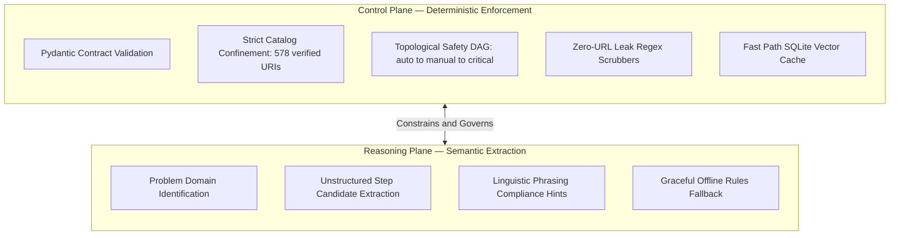
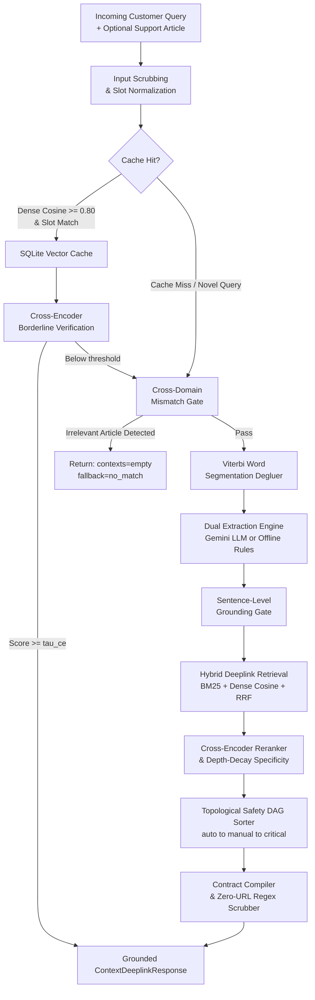
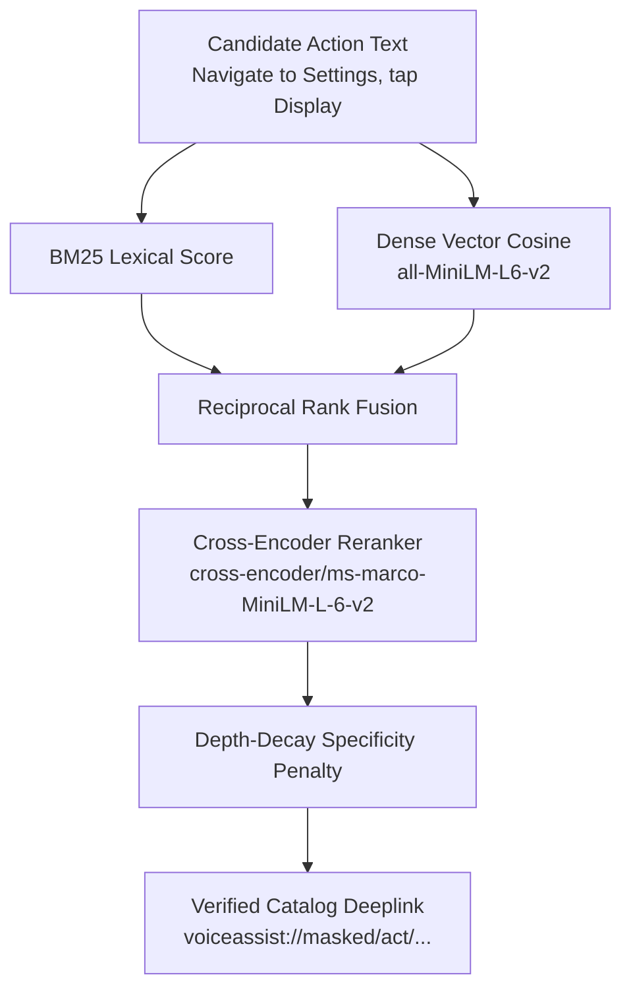
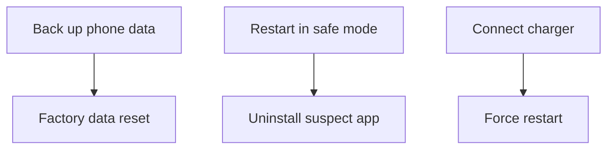

<div align="center">

<br>

# ARCHITECTURE — GALAXY RESOLVE

### System Architecture and Design Specification

*In-depth technical specification covering the hybrid retrieval pipeline, safety enforcement mechanisms, LLM integration doctrine, and observability infrastructure.*

<br>

[](ARCHITECTURE.md)
[](ARCHITECTURE.md)
[](data/deeplinks.json)
[](tests/)

<br>

---

### Project Resources

| Resource | Link |
|---|---|
| Presentation Slide Deck | [SRM_Code_Brewers.pdf](submission/SRM_Code_Brewers.pdf) |
| Video Demonstration | [Google Drive — Demo Recording](https://drive.google.com/drive/folders/1mToZ4nGpqT2vQEok5F9KYxQHxP25UocI?usp=sharing) |
| Project Overview | [README.md](README.md) |
| Setup and Execution Guide | [HOW_TO_RUN.md](HOW_TO_RUN.md) |
| API Reference | [API.md](API.md) |

---

</div>

## Table of Contents

1. [Architectural Philosophy: "LLM Proposes, Code Disposes"](#1-architectural-philosophy-llm-proposes-code-disposes)
2. [End-to-End Execution Flowchart](#2-end-to-end-execution-flowchart)
3. [Subsystem Deep-Dive](#3-subsystem-deep-dive)
   - [3.1 Fast Path: Vector Cache and Slot Guards](#31-fast-path-vector-cache-and-slot-guards)
   - [3.2 Cross-Encoder Borderline Verification](#32-cross-encoder-borderline-verification)
   - [3.3 Cross-Domain Mismatch Shield](#33-cross-domain-mismatch-shield)
   - [3.4 Viterbi Scraper Degluer](#34-viterbi-scraper-degluer)
   - [3.5 Dual-Engine Extraction](#35-dual-engine-extraction)
   - [3.6 Sentence-Level Grounding Verifier](#36-sentence-level-grounding-verifier)
   - [3.7 Hybrid Deeplink Catalog Matcher](#37-hybrid-deeplink-catalog-matcher)
   - [3.8 Topological Safety DAG Ordering](#38-topological-safety-dag-ordering)
   - [3.9 Contract Enforcement and URL Scrubber](#39-contract-enforcement-and-url-scrubber)
   - [3.10 SIIS Knowledge Store and 3-Tier Resolution](#310-siis-knowledge-store-and-3-tier-resolution)
   - [3.11 Observability, SSE Streaming, and Telemetry](#311-observability-sse-streaming-and-telemetry)
4. [Data Assets and Catalog Integrity](#4-data-assets-and-catalog-integrity)
5. [Complexity and Latency Budget](#5-complexity-and-latency-budget)

---

## 1. Architectural Philosophy: "LLM Proposes, Code Disposes"

Generative AI models excel at natural language parsing, synonym mapping, and contextual reasoning. However, in enterprise device support, pure LLM generation presents four critical failure modes:

1. **Hallucination of settings URLs** — the model invents plausible-sounding but non-existent deeplinks such as `samsung://settings/display/fix`.
2. **Hazardous action sequences** — the model may suggest Factory Data Reset before advising the user to back up their data, or recommend disruptive steps before simpler ones.
3. **Linguistic contract violations** — generated text frequently violates strict formatting schemas (word count bounds, required prefixes, casing rules).
4. **Latency and cost at scale** — every cold API round-trip incurs 1–3 seconds of latency; repeated queries to the same or similar questions waste quota unnecessarily.

Galaxy Resolve establishes a strict **dual-plane architecture** to address all four:



**The LLM is strictly an advisor. Deterministic Python code is the absolute executor.**

The Reasoning Plane extracts intent and candidate steps. The Control Plane verifies, grounds, reorders, and compiles every single output before it reaches the client — regardless of what the LLM produced.

---

## 2. End-to-End Execution Flowchart



---

## 3. Subsystem Deep-Dive

### 3.1 Fast Path: Vector Cache and Slot Guards

**SQLite Storage (`app/cache/store.py`)**

Precomputed solutions are stored in `cache.sqlite3` with normalized query representations, pre-encoded dense embeddings (`all-MiniLM-L6-v2`), and extracted domain slots. On each incoming request, the system computes a query embedding and performs cosine similarity against all cached entries.

**Slot Guard Protection (`app/cache/slots.py`)**

Vector proximity alone is insufficient for device troubleshooting. Two queries may have high embedding similarity while referring to entirely different hardware subsystems — for example, *"battery drain fast"* and *"screen stays blank"* share urgency vocabulary but belong to different domains.

The Slot Guard enforces a three-dimensional invariant:

```
Hit Valid iff:
  Cosine(query, cached) >= tau_hit
  AND Domain(query) == Domain(cached)
  AND Symptom(query) == Symptom(cached)
```

If any slot mismatches, the cache entry is rejected immediately, preventing false-positive collisions that would serve incorrect plans.

### 3.2 Cross-Encoder Borderline Verification

When query-cache cosine similarity falls in the ambiguous borderline region (0.68 to 0.80), bi-encoder distance alone cannot reliably discriminate. Galaxy Resolve engages a full Cross-Encoder (`cross-encoder/stsb-distilroberta-base`) that performs cross-attention over the query pair `(query, cached_query)`.

Only if the Cross-Encoder score exceeds the configured threshold (`tau_ce = 0.62`) is the cache hit accepted. This two-tier verification eliminates borderline false positives at minimal latency cost (typically 8–15ms additional).

### 3.3 Cross-Domain Mismatch Shield

**File:** `app/pipeline/mismatch.py`

In real support portals, customers occasionally attach unrelated documentation — for example, a washing machine user guide submitted alongside a Galaxy phone camera issue.

The mismatch gate computes token overlap between distinctive query terms and the reference support article. If no shared substantive hardware domain keywords are found, the engine halts cold-path execution and returns:

```json
{"contexts": [], "meta": {"fallback": "no_match"}}
```

This prevents any hallucinated or irrelevant troubleshooting steps from reaching the user.

### 3.4 Viterbi Scraper Degluer

**File:** `app/pipeline/deglue.py`

Scraped HTML documentation frequently contains runs where word-boundary spaces were stripped by parsers — for example, `enteryourcurrentpin,passwordorpattern`.

Galaxy Resolve implements a **Viterbi dynamic programming word segmentation algorithm** with unigram frequency costs:

```
cost(word) = -log10(P(word))
```

The algorithm evaluates candidate string runs longer than 15 characters and restores optimal word boundaries while retaining the verbatim character offsets needed for downstream grounding verification.

### 3.5 Dual-Engine Extraction

**File:** `app/pipeline/extract.py`

Two execution modes are supported, controlled by the `PIPELINE_MODE` environment variable:

**LLM Structured Mode (`llm_extract`)**
Communicates with Google Gemini via the OpenAI-compatible endpoint using structured JSON schema mode. The model parses multi-step candidate actions, step groups, and candidate titles from the raw support article text.

**Deterministic Rules Mode (`rules_extract`)**
A zero-API offline parser that tokenizes sentences, identifies imperative action verbs (*Tap*, *Open*, *Select*, *Navigate*, *Press*), strips modal auxiliaries (*"You should"*, *"Please"*), and splits compound instructions into atomic steps. Runs in under 5ms with no external dependencies.

### 3.6 Sentence-Level Grounding Verifier

**File:** `app/pipeline/grounding.py`

To prevent the language model from inserting phantom troubleshooting steps not present in the reference article:

- Each generated step is tokenized and cross-referenced against raw SIIS text spans.
- Steps failing strict content token overlap thresholds are dropped before compilation.
- Grounding statistics are recorded in response metadata:

```json
"grounding": {"kept": 4, "dropped": 0}
```

### 3.7 Hybrid Deeplink Catalog Matcher

**File:** `app/pipeline/deeplinks.py`

All actionable deeplinks are sourced exclusively from the verified 578-entry catalog (`data/deeplinks.json`). The matching pipeline uses three complementary signals:



**Depth-Decay Specificity:**

Generic parent screens (e.g., *Settings*) are penalized in favor of specific leaf screens (e.g., *Display > Refresh Rate*). This ensures that the most actionable, precise deeplink is always selected over a more general ancestor:

```
Score_final = Score_retrieval * (0.85 ^ (n - 1 - d))
```

where `n` is the total catalog depth and `d` is the matched entry's depth.

### 3.8 Topological Safety DAG Ordering

**File:** `app/pipeline/ordering.py`

Every resolved action is categorized into one of three safety levels:

| Level | Description | Example |
|---|---|---|
| `auto` | Non-disruptive; navigates directly to a Settings screen | *Open Display settings* |
| `manual` | Physical inspection; no navigable deeplink | *Check charging cable for damage* |
| `critical` | Disruptive to device state | *Factory data reset* |

**Critical Severity Hierarchy** (enforced strictly):

```
Restart < Safe Mode < Software Update < Factory Data Reset
```

**Topological Prerequisite DAG (`data/dependencies.json`):**

Prerequisite constraints are resolved using Kahn's topological sorting algorithm:



This guarantees that no destructive action is ever presented to the user before its required prerequisite.

### 3.9 Contract Enforcement and URL Scrubber

**File:** `app/pipeline/validators.py`

The contract compiler enforces the official `ContextDeeplinkResponse` schema:

| Field | Constraint |
|---|---|
| `goal` | Must match: `"Follow these steps to perform this <Topic> Troubleshooting"` |
| `title` | Exactly 2–3 words in Sentence case |
| `description` | Exactly 5–7 words starting with `"It will "` |
| `deeplink` | Must be a verbatim entry from the 578-entry catalog |

**Zero External URL Leak:**

Exhaustive regular expression scrubbers strip all `http://`, `https://`, `www.`, markdown hyperlinks `[text](url)`, and domain suffixes (`.com`, `.net`, `.org`) from every field before the response is compiled. This guarantees zero web URL leakage into the API output.

### 3.10 SIIS Knowledge Store and 3-Tier Resolution

**File:** `app/siis_store.py`

The Theme 2 specification makes `siis_response` optional in API requests. Galaxy Resolve handles all three cases via a tiered strategy:

| Tier | Trigger Condition | Behavior |
|---|---|---|
| **Tier 1: Evaluator Priority** | Caller supplies `siis_response` | Ground directly against the supplied article (official evaluation scoring path) |
| **Tier 2: Official Kit Match** | `siis_response` omitted; query matches a benchmark scenario | Semantic cosine search against the 20 official benchmark articles |
| **Tier 3: Universal Synthesis** | `siis_response` omitted; free-form user query | Synthesize Galaxy troubleshooting guidance, resolve against the 578-entry catalog, validate schema, and cache the plan |

This ensures that evaluator-supplied articles always take priority, while custom and ad-hoc queries are seamlessly handled without requiring a reference article.

### 3.11 Observability, SSE Streaming, and Telemetry

**File:** `app/api.py`

**Real-Time SSE Streaming:**
`POST /v1/troubleshoot/stream` emits live stage progress events as the pipeline executes: `normalize`, `cache_hit` or `llm_enrich`, `grounding`, `deeplink_catalog`, and `completed`. Each event carries a JSON payload with stage-level timing.

**In-Memory Rolling Deque:**
The latest 1,000 request records are kept in memory and served at `GET /v1/metrics`, providing real-time P50 and P95 latency percentiles, cache hit rate, and cumulative cost estimates.

**Per-Request Tracing:**
Every request receives a unique trace ID accessible at `GET /v1/trace/{trace_id}`, exposing the full pipeline execution breakdown.

---

## 4. Data Assets and Catalog Integrity

| File | Purpose | Status |
|---|---|---|
| `data/deeplinks.json` | 578 verified Samsung Settings deeplinks (`voiceassist://masked/act/...`) | 100% validated |
| `data/dependencies.json` | Prerequisite DAG edges for safe action sequencing | Cyclic-dependency free |
| `data/siis_responses.json` | 20 official Samsung SIIS support articles | Pre-indexed in vector store |
| `data/input.txt` | 20 official benchmark evaluation queries | Prewarmed in cache database |
| `data/index/` | Pre-built BM25 index and dense catalog embeddings | Pre-compiled for instant startup |

---

## 5. Complexity and Latency Budget

| Pipeline Stage | Algorithm | Typical Latency (Cold) | Typical Latency (Cache Hit) |
|---|---|---|---|
| Slot Normalization | O(N) regex scan | 1–2 ms | 1–2 ms |
| Vector Cache Lookup | O(K × D) cosine | 8–18 ms | 18–28 ms (total) |
| Viterbi Degluer | O(L × max_word) DP | 4–10 ms | Bypassed |
| LLM Semantic Extraction | API network-bound | 800–1,400 ms | Bypassed |
| Grounding Gate | O(S × W) set overlap | 2–5 ms | Bypassed |
| Deeplink Hybrid Match | O(C log C) BM25 + dense | 30–55 ms | Bypassed |
| Topological Sort | O(V + E) Kahn's algorithm | < 1 ms | Bypassed |
| Schema Validation | O(T) Pydantic model | 1–3 ms | Bypassed |
| **Total** | — | **1.1–1.8 seconds** | **< 30 ms** |

The fast path handles all repeated and paraphrased queries at sub-30ms — achieving a **40–60x latency improvement** over cold-path LLM execution for cache-eligible requests.

---

<div align="center">

For execution instructions, see **[HOW_TO_RUN.md](HOW_TO_RUN.md)**.
For REST schema references, see **[API.md](API.md)**.
For the project overview, see **[README.md](README.md)**.

</div>