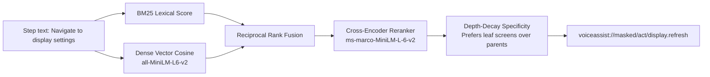
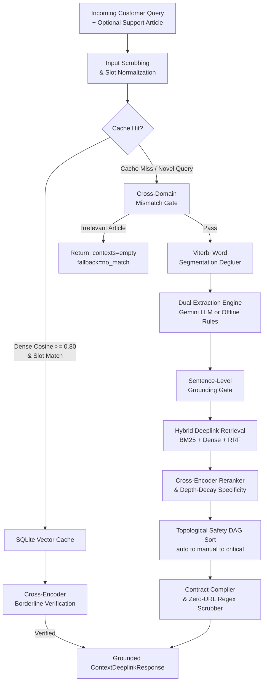

<div align="center">

<br>

# GALAXY RESOLVE

### Smart Guided Troubleshooting Engine for Samsung Galaxy Devices

*Transforming vague user complaints into grounded, ordered, schema-compliant troubleshooting plans — with direct Samsung Settings deeplinks, sub-30ms cache performance, and real-time streaming.*

<br>

[](https://www.python.org/)
[](https://fastapi.tiangolo.com/)
[](https://react.dev/)
[](https://deepmind.google/technologies/gemini/)
[](tests/)
[](LICENSE)

<br>

---

### Project Resources

| Resource | Link |
|---|---|
| Presentation Slide Deck | [SRM_Code_Brewers.pdf](submission/SRM_Code_Brewers.pdf) |
| Video Demonstration | [Google Drive — Demo Recording](https://drive.google.com/drive/folders/1mToZ4nGpqT2vQEok5F9KYxQHxP25UocI?usp=sharing) |
| Setup and Execution Guide | [HOW_TO_RUN.md](HOW_TO_RUN.md) |
| System Architecture | [ARCHITECTURE.md](ARCHITECTURE.md) |
| API Reference | [API.md](API.md) |
| AI and Tool Disclosure | [DISCLOSURE.md](DISCLOSURE.md) |

---

</div>

## Table of Contents

1. [Overview](#overview)
2. [The Problem We Solve](#the-problem-we-solve)
3. [Core Features](#core-features)
4. [System Architecture](#system-architecture)
5. [Technology Stack](#technology-stack)
6. [API Summary](#api-summary)
7. [Web Console](#web-console)
8. [Testing and Quality](#testing-and-quality)
9. [Project Structure](#project-structure)
10. [Quick Start](#quick-start)
11. [License](#license)

---

## Overview

When Samsung Galaxy device users encounter issues, their natural language descriptions are typically vague, symptom-driven, or colloquial — *"My phone screen flickers after unlocking"*, *"Battery draining fast while playing games"*, *"Touch gestures going wrong direction"*.

**Galaxy Resolve** is a high-performance, AI-powered troubleshooting engine that converts these free-form complaints into precise, actionable, schema-compliant resolution plans — complete with direct Samsung Settings deeplinks that open the exact settings screen needed.

Built on the principle of **"LLM Proposes, Code Disposes"**, the system uses semantic AI for language understanding but enforces correctness, safety ordering, and zero-hallucination guarantees entirely through deterministic code.

---

## The Problem We Solve

| User Input | What Galaxy Resolve Delivers |
|---|---|
| *"My screen keeps flickering"* | 4-step ordered plan: Disable adaptive refresh → Adjust touch sensitivity → Update display drivers → Reset display settings — with verified `voiceassist://` deeplinks |
| *"Battery draining so fast"* | Ordered steps from safe (check battery usage) to critical (factory reset) with mandatory backup prerequisite enforced |
| *"Audio not coming out"* | Deeplink-grounded plan: Check volume → Bluetooth audio routing → Sound mode reset → Safe mode test |
| *"Phone is hot all the time"* | Plan ordered from auto settings steps to manual inspection, with no disruptive actions before safe alternatives |

Every response is schema-validated, URL-scrubbed, dependency-ordered, and grounded against official Samsung support content.

---

## Core Features

### Query Normalization and Spell Correction
Incoming complaints are normalized before any AI or cache lookup. Spell correction, URL scrubbing, and slot extraction convert noisy natural language (typos, slang, mixed case) into a clean canonical form. This ensures consistent matching regardless of how a user phrases their issue.

### Two-Tier Semantic Cache — Sub-30ms Fast Path
Repeated and similar queries are served from a SQLite vector cache in under 30ms:
- **Tier 1 — Exact Match:** SHA-256 hash lookup in under 6ms for verbatim repeated queries.
- **Tier 2 — Vector Search:** FAISS-backed cosine similarity search identifies paraphrased or near-identical queries. A **Near-Miss Slot Guard** blocks category-crossing false hits, ensuring a cached plan for *"battery drain"* is never served for *"screen blank"* even if their embeddings are proximate.
- **Cross-Encoder Borderline Verification:** Queries in the ambiguous similarity range (0.68–0.80) undergo full cross-attention reranking before a cache hit is confirmed.

### LLM Intent Enrichment with Deterministic Fallback
For novel queries, Google Gemini 2.5 Flash extracts the hardware domain, sub-domain, problem category, and candidate troubleshooting steps from the Samsung support article. The model operates in structured JSON schema mode to ensure parseable output.

**Critically, if Gemini is unavailable, rate-limited, or the API key is absent, the engine automatically falls back to a deterministic rule-based extractor** — tokenizing sentences, identifying imperative verbs (Tap, Open, Select), and splitting compound instructions. This fallback runs in under 50ms with zero external dependencies.

### SIIS Grounding — Hallucination Elimination
Each LLM-extracted step is cross-referenced against the raw Samsung support article text at the sentence level. Steps that lack textual evidence — phantom actions the model invented that do not appear in the source material — are silently dropped before compilation. Grounding statistics are recorded in every response:

```json
"grounding": {"kept": 4, "dropped": 0}
```

### Hybrid Deeplink Catalog — 578 Verified Samsung Settings URIs
Every actionable step must resolve to a verified entry in the 578-entry Samsung deeplink catalog (`data/deeplinks.json`). Resolution uses a three-signal hybrid retrieval system:



**Depth-Decay Specificity** penalizes generic parent screens in favor of precise leaf screens — so *Display > Refresh Rate* is always preferred over just *Display*.

### Schema Validation — 100% Contract Conformance
Every compiled plan is validated against the Pydantic `ContextDeeplinkResponse` schema before it is returned:

| Field | Rule |
|---|---|
| `goal` | Must match: `"Follow these steps to perform this <X> Troubleshooting"` |
| `title` | Exactly 2–3 words, Sentence case |
| `description` | Exactly 5–7 words, must start with `"It will "` |
| `deeplink` | Must be a verbatim entry from the 578-entry catalog |

Invalid actions are repaired where possible; otherwise they are dropped — **they are never surfaced to the user**.

### Topological Safety DAG — Safe Action Ordering
Actions are ordered by safety level and prerequisite constraints. Two guarantees are always enforced:

**Safety Hierarchy (never reversed):**
```
Restart → Safe Mode → Software Update → Factory Reset
```

**Prerequisite DAG (from `data/dependencies.json`):**
- *Back up phone data* must precede *Factory data reset*
- *Restart in safe mode* must precede *Uninstall suspect app*
- *Connect charger* must precede *Force restart*

Factory Reset is never the first recommendation. It always appears last, and only after safer alternatives.

### Zero External URL Leaks
Exhaustive regex scrubbers run on every field of every response, stripping all `http://`, `https://`, `www.`, markdown hyperlinks, and domain suffixes (`.com`, `.net`, `.org`). Zero external web URLs are ever present in any API output.

### Cross-Domain Mismatch Shield
If the supplied reference article is completely unrelated to the user's complaint (e.g., a washing machine manual paired with a phone screen query), the engine detects the mismatch via token overlap analysis and halts processing:

```json
{"contexts": [], "meta": {"fallback": "no_match"}}
```

No hallucinated actions are generated. No irrelevant plan is returned.

### Viterbi Scraper Degluer
Samsung support articles scraped from HTML frequently contain runs of concatenated text where spaces were stripped — e.g., `enteryourcurrentpin,passwordorpattern`. Galaxy Resolve applies a Viterbi dynamic programming word segmentation algorithm with unigram frequency costs to restore word boundaries before extraction.

### Auto SIIS Article Matching — 3-Tier Resolution
When no reference article is supplied by the caller, Galaxy Resolve resolves it automatically:

| Tier | Condition | Action |
|---|---|---|
| 1 | Caller supplies `siis_response` | Ground against the supplied article (evaluation path) |
| 2 | No article; query matches a benchmark scenario | Semantic search against 20 official Samsung benchmark articles |
| 3 | No article; free-form custom query | Synthesize Galaxy guidance, resolve against catalog, cache the plan |

### Real-Time SSE Streaming
`POST /v1/troubleshoot/stream` streams live pipeline progress to the client as each stage completes — normalize, extract, ground, deeplink, compile — with per-stage latency measurements in each event.

### Built-In Observability
- **Rolling Metrics Deque:** Tracks the latest 1,000 requests, serving real-time P50 and P95 latency percentiles and cache hit rate at `GET /v1/metrics`.
- **Per-Request Tracing:** Every request is assigned a unique trace ID for deep-inspection at `GET /v1/trace/{trace_id}`.

---

## System Architecture



For the complete architectural specification, component contracts, and latency budget analysis, see **[ARCHITECTURE.md](ARCHITECTURE.md)**.

---

## Technology Stack

| Layer | Technology | Purpose |
|---|---|---|
| **API Server** | FastAPI + Uvicorn | REST API, SSE streaming, health, metrics |
| **LLM** | Google Gemini 2.5 Flash | Intent extraction, step generation |
| **Embeddings** | `sentence-transformers/all-MiniLM-L6-v2` | Dense query and catalog vectorization |
| **Reranking** | `cross-encoder/ms-marco-MiniLM-L-6-v2` | Deeplink candidate reranking |
| **Cache Verification** | `cross-encoder/stsb-distilroberta-base` | Borderline cache hit confirmation |
| **Lexical Search** | BM25 (rank-bm25) | First-stage catalog retrieval |
| **Cache Store** | SQLite + cosine | Vector cache and slot guard storage |
| **Schema Validation** | Pydantic v2 | Response contract enforcement |
| **Frontend** | React 19 + Vite | Interactive web console |
| **Containerization** | Docker | Deployment packaging |

---

## API Summary

| Method | Endpoint | Description |
|---|---|---|
| `GET` | `/` | Interactive web console with simulated Galaxy device frame |
| `GET` | `/health` | Service readiness: model, catalog, cache, and LLM connectivity |
| `POST` | `/v1/troubleshoot` | Single-shot troubleshooting plan resolution (official evaluation path) |
| `POST` | `/v1/troubleshoot/stream` | Server-Sent Events streaming with live reasoning trace |
| `GET` | `/v1/metrics` | Rolling 1,000-request P50/P95 latency, cache hit rate, and cost |
| `GET` | `/v1/trace/{trace_id}` | Full per-request execution trace and pipeline metadata |

For complete request schemas, response contracts, and example payloads, see **[API.md](API.md)**.

---

## Web Console

Galaxy Resolve ships with a built-in dark-mode web console served directly by FastAPI — no separate deployment required.

- **Interactive Demo** — enter any device complaint or select from 20 official benchmark scenarios
- **Live Pipeline Trace** — watch each pipeline stage execute in real time via Server-Sent Events
- **Simulated Galaxy Frame** — troubleshooting plan rendered inside a One UI smartphone interface with tappable deeplink action buttons
- **Metrics Dashboard** — rolling P50/P95 latency, cache hit rate, estimated API cost, and full request history with trace IDs

---

## Testing and Quality

Galaxy Resolve maintains **101 automated tests** covering all critical modules:

```bash
python -m pytest tests/ -v
```

| Test Module | What It Validates |
|---|---|
| `tests/test_api_and_outputs.py` | REST contracts, schema validation, SSE streaming, metrics correctness |
| `tests/test_ordering.py` | Topological DAG ordering, safety severity hierarchy, prerequisite chains |
| `tests/test_deeplinks.py` | Catalog URI matching, leaf specificity scoring, zero URL leak guarantee |
| `tests/test_deglue.py` | Viterbi segmentation accuracy on scraper-produced concatenated text |
| `tests/test_mismatch.py` | Cross-domain article rejection and fallback behavior |
| `tests/test_engine.py` | End-to-end plan resolution, offline fallback paths, slot guard enforcement |
| `tests/test_validators.py` | Word count bounds, "It will" prefix enforcement, zero-URL scrubbing |

---

## Project Structure

```text
Galaxy-Resolve/
├── app/
│   ├── api.py               # FastAPI routes, SSE streaming, rolling metrics window
│   ├── config.py            # Central configuration and environment variables
│   ├── embed.py             # SentenceTransformers and CrossEncoder model loading
│   ├── engine.py            # Core pipeline orchestrator (fast path / cold path)
│   ├── llm.py               # Google Gemini client with OpenAI-compatible fallback
│   ├── schema.py            # Pydantic response contract (ContextDeeplinkResponse)
│   ├── siis_store.py        # SIIS knowledge store with 3-tier auto-matching
│   ├── static/              # Compiled React 19 SPA (served directly by FastAPI)
│   ├── cache/               # SQLite vector store, slot guards, and cache logic
│   └── pipeline/            # Extraction, grounding, degluing, ordering, deeplinks
├── data/
│   ├── deeplinks.json       # 578 verified Samsung Settings deeplink entries
│   ├── dependencies.json    # Prerequisite DAG edges for safe action sequencing
│   └── siis_responses.json  # 20 official Samsung SIIS support articles
├── eval/                    # Evaluation harness and benchmark scoring scripts
├── frontend/                # React 19 + Vite source (for development only)
├── scripts/
│   ├── build_index.py       # Builds catalog vector embeddings and BM25 indexes
│   └── prewarm.py           # Prewarming script for all baseline benchmark scenarios
├── submission/
│   └── SRM_Code_Brewers.pdf # Competition presentation slide deck
├── tests/                   # Pytest test suite — 101 tests
├── ARCHITECTURE.md          # In-depth architectural specification and design
├── HOW_TO_RUN.md            # Complete setup, execution, and evaluation guide
└── API.md                   # REST and SSE endpoint schema reference
```

---

## Quick Start

```bash
# Clone and install
git clone https://github.com/Bhavy-official/Galaxy-Resolve.git
cd Galaxy-Resolve
python -m venv .venv && .\.venv\Scripts\Activate.ps1  # Windows
pip install -r requirements.txt

# Configure (add your free Gemini API key, or leave blank for offline mode)
cp .env.example .env

# One-time index build and cache prewarm
python scripts/build_index.py
python scripts/prewarm.py

# Start the server
python -m uvicorn app.api:app --host 0.0.0.0 --port 8000 --reload
```

Open **http://localhost:8000/** in your browser. For full setup instructions, Docker deployment, and evaluation harness, see **[HOW_TO_RUN.md](HOW_TO_RUN.md)**.

---

## License

This project is licensed under the **MIT License** — see the [LICENSE](LICENSE) file for details.

<div align="center">

---

Built by **Team - Code Brewers SRM** — Theme 2: Smart Guided Troubleshooting Engine

[HOW_TO_RUN.md](HOW_TO_RUN.md) &nbsp;|&nbsp; [ARCHITECTURE.md](ARCHITECTURE.md) &nbsp;|&nbsp; [API.md](API.md) &nbsp;|&nbsp; [Slide Deck](submission/SRM_Code_Brewers.pdf) &nbsp;|&nbsp; [Video Demo](https://drive.google.com/drive/folders/1mToZ4nGpqT2vQEok5F9KYxQHxP25UocI?usp=sharing)

</div>